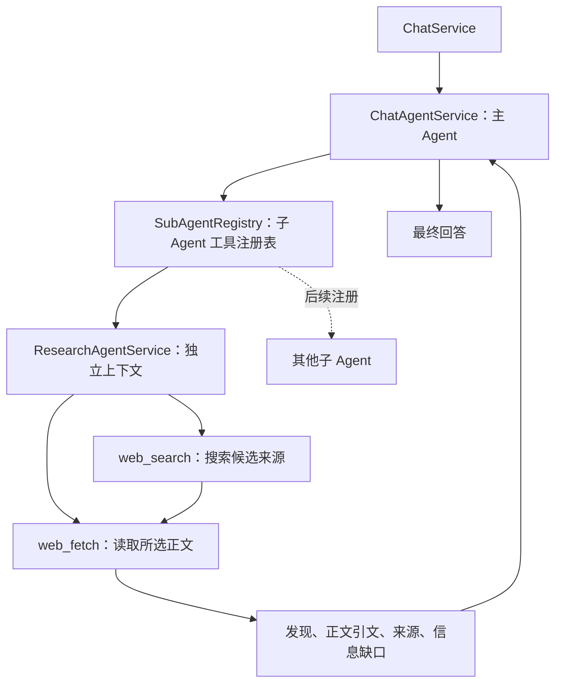

# Chat Agent 架构与扩展

Chat 使用一个主 Agent 和按需调用的子 Agent。目前仅注册 Research Agent；子任务串行执行，暂未引入并行调度。



## 公共接口

- `agents/agent-types.ts` 定义 `AgentTool` / `SubAgent`、`AgentContext`、`ToolResult` 和请求级 `AgentBudget`。
- `agents/agent-runtime.ts` 的 `runAgent()` 执行模型与工具循环，处理预算、工具结果回传、取消、历史和调试；它不依赖具体业务工具。
- `agents/sub-agent-registry.service.ts` 将注册的子 Agent 暴露为主 Agent 工具，检查重复及保留名称，统一消耗委派预算并设置调用归属。
- `chat.module.ts` 通过 `SUB_AGENTS` 注入具体子 Agent 列表。主 Agent 只依赖注册表，不依赖 Research Agent 或网页工具。

`AgentContext` 包含当前模型配置、取消信号、共享预算、调用归属，以及可选的记录、进度和调试对象。当前子 Agent 继承用户选择的模型。子 Agent 的上下文由自己的提示词和委派任务构成，不自动复制聊天历史或图片；主 Agent 应将必要事实和约束写进任务。

`ToolResult` 返回 `data`、`sources` 和可选 `warning`。Research 的 `data` 是结构化发现和证据，不是抓取到的整篇网页。子 Agent 内部工具输出标记 `internal: true`，仅用于历史详情与调试，不自动发布其来源或失败提示到最终聊天；对外来源由子 Agent 完成核验后返回。

## 新增子 Agent

系统提示词、工具描述与报告修复提示集中在 `apps/api/src/chat/prompts/` 的 Markdown 文件中；编辑入口与生效方式见该目录的 `README.md`。主、子 Agent 分别通过 `agent-prompts.ts` 注入当前 UTC 时间与执行预算，工具按章节读取描述。接口结构与参数校验仍由 TypeScript 管理。

1. 创建 Nest provider，实现 `SubAgent`，声明唯一的工具名称、描述、JSON 参数定义，以及 `execute(rawArguments, context, callId)`。
2. 使用 Zod 等校验参数；创建调用级局部状态，避免在 singleton provider 上保存页面、缓存、历史或计数器。
3. 如需模型推理，使用 `runAgent()`，提供自己的系统提示词、独立上下文、专用工具和局部轮次 / 调用上限。复用 `context.budget`，所有模型、工具和 I/O 操作接收 `context.signal`。
4. 返回明确的任务结果与不足。发布的来源应可追溯到实际读取的证据，避免把内部工具日志当作最终结果。
5. 在 `ChatModule.providers` 注册 provider，加入 `SUB_AGENTS` 工厂的参数、`inject` 数组和返回列表。无需修改 `ChatAgentService` 或公共执行循环。
6. 验证独立上下文、取消、预算、流式输出隔离、历史记录和注册表发现。子 Agent 不应继续访问主 Agent 的注册表以递归委派。

新子 Agent 可拥有自己的工具和结果格式；当前整体委派上限是 2 次，推理上限是 150 轮（主 Agent 50 轮与两次子任务各 50 轮）。扩展时应结合任务评估调整预算，并同步协议中轮次、阶段和调试事件的上限。

## Research 执行

主 Agent 调用 `research({ task })`，任务必须包含具体问题、必要历史事实、地域、时间和验收要求。

Research Agent 明确任务对象、核心问题、范围和时间要求后直接搜索、筛选候选并读取正文；任务已有明确 URL 时可以直接读取。

`web_search({ url })` 直接请求模型选择的完整搜索结果页 URL，获取最多 10 条去重候选。模型自行选择搜索引擎、关键词和语言、市场、站点限定等参数；服务端不内置搜索地址、不添加查询参数。URL 最长 2048 字符，沿用公开 HTTP/HTTPS 地址、DNS 和逐次重定向校验。支持 Bing、Google、百度和 DuckDuckGo 的常见 HTML 搜索结果页；无法解析时返回明确错误，由模型更换搜索 URL 或使用 `web_fetch`。原始独立短问题只作为模型构造 URL 的参考，正文核验通过 `web_fetch({ url })` 执行。同一次委派的重复 URL（忽略片段）复用缓存，后续委派重复提交同一 URL 时返回 `duplicate_search_url`；不同搜索引擎、路径或查询参数分别计数，不将 URL 转为小写或改写查询。缓存与跨委派重复拦截均不发请求或消耗搜索额度。额度耗尽后不再向模型展示 `web_search`。Research 报告的 `attemptedSearchUrls` 记录本次子任务实际提交过的搜索 URL。

最终调用 `research_report` 提交结构化报告，提交后直接结束子任务，无需额外文本回复。仍兼容通过校验的旧式 JSON 回复：

```json
{
  "findings": [
    {
      "claim": "受证据支持的发现",
      "evidence": [
        {
          "url": "https://example.com/article",
          "quote": "从实际读取正文中连续摘录且包含必要上下文的证据片段"
        }
      ]
    }
  ],
  "gaps": []
}
```

每条引文在归一化空白后至少 6 字符，且必须连续出现在已读取的最终 URL 正文里。服务端丢弃无法核验的引文并记录缺口，只有仍有可核验引文的发现才会返回。主 Agent 应以剩余引文支持的内容作答。此校验验证引文出处和存在性，不证明结论本身正确。

`findings` 或 `gaps` 若被编码为合法 JSON 数组字符串，服务端解码一次并继续严格校验。提交错误时 `research_report` 返回具体字段路径。只返回思考、空报告或格式无效时，在原有轮次预算内最多修复两次；最后一轮及最后一次工具调用仅用于提交报告。有效报告中的证据不足是正常缺口；无法恢复的报告错误和执行异常向外抛出 502，研究超时抛出 504，取消继续传播。父 Research 工具与聊天历史记为失败，流式接口发送 error，调试错误包含 Agent 与父调用归属。

补交报告时保留上一轮思考内容。模型传输层将 `content: null` 转为字符串 `""`，兼容 Ollama 对无工具调用的 assistant 消息的格式要求；调试请求记录使用相同的规范化消息。模型 API 的非 200 响应最多读取 16 KB，从识别出的 JSON 错误中提取最多 500 字符的原因，并隐藏当前 API Key 与 Bearer 凭据。HTTP 400 保留具体格式错误，不统一解释为不支持联网工具；鉴权与限流仍使用专门提示。

每个 Research 子任务最多 2 次搜索、5 次不同 URL 的读取尝试、50 轮推理、100 次工具调用和 240 秒；主 Agent 最多 50 轮、100 次调用，所有 Agent 共享 150 轮推理预算。`ResearchWebSession` 管理每次调用的页面、缓存和次数。搜索与读取结果按查询 / 规范化 URL 缓存，包括失败结果；命中缓存仍消耗工具循环调用次数，但不消耗新的搜索或读取次数。读取保留原有公网访问、DNS、重定向、12 秒时限、解压前后 2 MB 和 12,000 字符正文限制。

返回给主 Agent 的 Research 结果由服务端补充 `stopReason`、`pagesRead` 和 `budget`。`budget.searchesRemaining`、`budget.fetchesRemaining` 属于这次子任务，`budget.delegationsRemaining` 属于整个聊天请求。有效报告有通过引文校验的发现时标记 `verified_evidence`，仍可能带 `gaps`；无发现时依次区分被轮次或调用预算迫使提交报告（`turn_budget_exhausted` / `tool_call_budget_exhausted`）、读取或搜索额度耗尽（`fetch_budget_exhausted` / `search_budget_exhausted`），以及 `no_pages_read` / `insufficient_evidence`。无效任务或被拒绝的委派未创建联网会话，只返回请求级剩余额度和 `invalid_task` / `delegation_budget_exhausted`。主 Agent 检查关键缺口，有剩余委派额度且有不同的可行策略时可再次委派，新子任务会获得独立的搜索与读取额度。

## 记录与展示

所有 Agent 的模型轮次在请求内递增，避免数据库 `(historyId, round)` 冲突。调试事件增加 `agent` 与 `parentToolCallId`，父工具标识使用 `轮次:原始调用 ID`。回复的归属保存在已有 `timings` JSON 字段中，无需新增数据库迁移。

Research 的中间正文、思考和报告不作为用户回答流式输出，但仍记录在历史详情。只有主 Agent 的完成回复标记 `isFinal`。聊天历史恢复时选择主 Agent 回复，兼容没有归属字段的旧记录，也不会在取消研究后显示子 Agent 的部分 JSON。

进度保留外层委派和内层网页工具的独立时间区间，通过请求内唯一调用标识关闭对应区间。上下文用量仍统计主 Agent 最后一次推理的输入与输出，不累计子 Agent 的计费用量。
